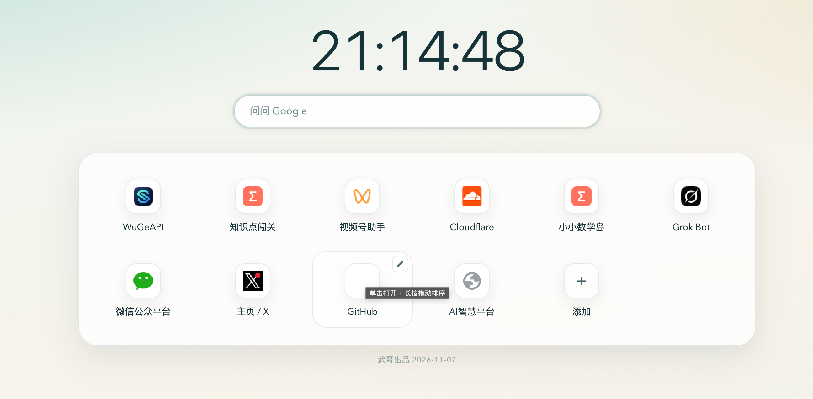

# 武哥新标签页

Chrome 原生「添加快捷方式」需要手动填写名称和网址，且无法直接把当前打开的页面一键固定。本项目提供：

- **浏览器扩展**：替换新标签页，支持一键添加当前页、书签面板等
- **网页版**：https://tab.wuge.xyz — 可设为任意手机/桌面浏览器主页，手动加卡片，数据存在本机

## 功能

- **长期固定卡片**（扩展：`chrome.storage.local`；网页：`localStorage`）
- **一键添加当前页面**（仅扩展：点击工具栏图标）
- **手动添加**（扩展与网页：点「+」卡片）
- **悬停编辑 / 弹窗删除**、**长按拖动排序**
- **白天 / 黑夜 / 跟随系统**
- **分享链接导入 / 导出**（扩展选项页或网页右上角设置；链接形如 `https://tab.wuge.xyz#wuge=...`）
- **书签模式**（仅扩展：点搜索框左侧书签按钮）

> 扩展与网页版数据相互独立，用分享链接同步即可。

## 网页版

1. 打开 [https://tab.wuge.xyz](https://tab.wuge.xyz)
2. （可选）在 Via / Chrome / Safari 等浏览器中设为「主页」
3. 点「+」添加卡片；右上角设置可切换主题、导入/导出

本地预览：在仓库根目录起静态服务后访问 `/index.html`（需支持 ES module）。

## 扩展安装

### Edge 应用商店（推荐）

在 [Microsoft Edge 加载项](https://microsoftedge.microsoft.com/addons/detail/%E6%AD%A6%E5%93%A5%E6%96%B0%E6%A0%87%E7%AD%BE%E9%A1%B5/beoomipjlkihfgbjdfmikmpiooipdkmk) 一键安装「武哥新标签页」。

### 开发者模式（Chrome / Edge）

1. 打开浏览器，进入 `chrome://extensions` 或 `edge://extensions`
2. 右上角打开「开发者模式」
3. 点击「加载已解压的扩展程序」
4. 选择本仓库目录（克隆后的 `chrome-tab` 文件夹）
5. 安装后新标签页会显示「武哥新标签页」
6. （建议）在扩展详情里打开「在工具栏中固定」，方便一键添加

## 开源协议

[MIT](./LICENSE)

## 使用

| 操作 | 方法 |
| --- | --- |
| 一键添加当前页 | 扩展：打开任意网页 → 点工具栏图标 → 确认名称 → 添加 |
| 手动添加 | 点「+」卡片 |
| 编辑 / 删除 | 鼠标经过卡片 → 点右上角编辑图标 |
| 排序 | 长按卡片后拖动 |
| 打开卡片 | 单击卡片 |
| 打开书签 | 仅扩展：点搜索框左侧书签按钮 |
| 导出 / 导入 | 扩展选项页，或网页版右上角设置；也可直接打开分享链接 |

## 说明

- 扩展无法添加 `chrome://`、`chrome-extension://` 等系统页
- 卸载扩展会移除自定义新标签页与扩展本地数据
- 网页版数据仅存于当前浏览器的 `localStorage`，清站点数据会丢失
- 换设备：生成分享链接，在另一端打开或粘贴导入
